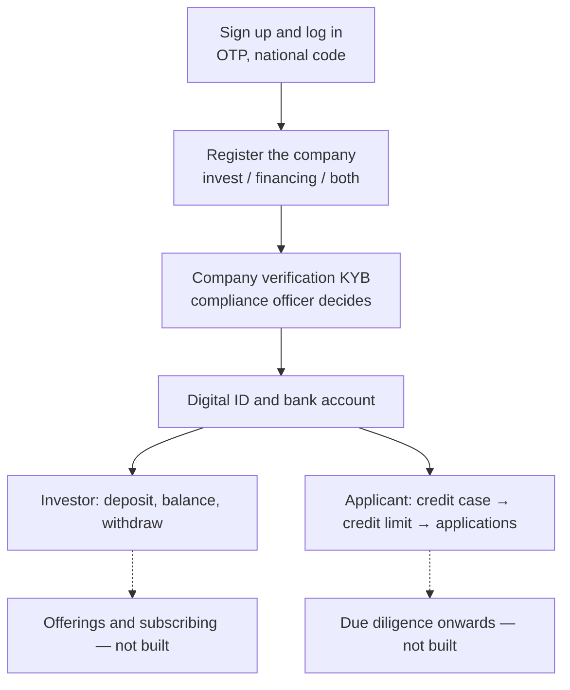
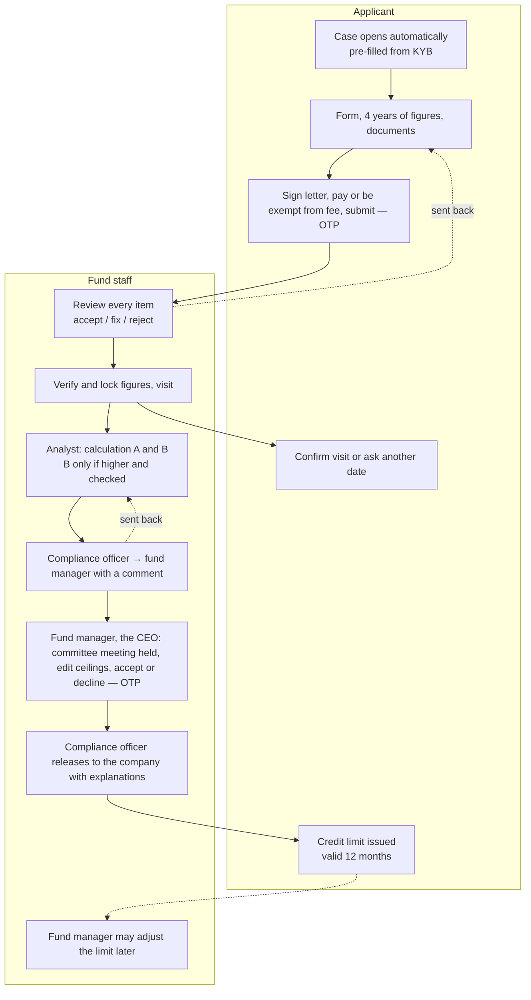
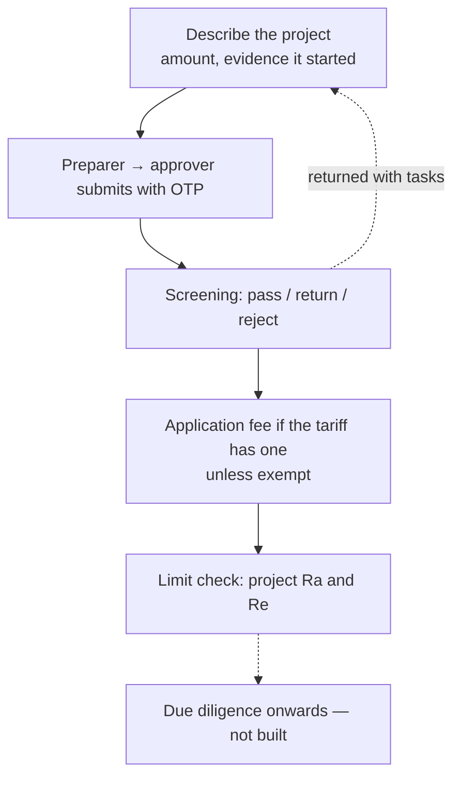
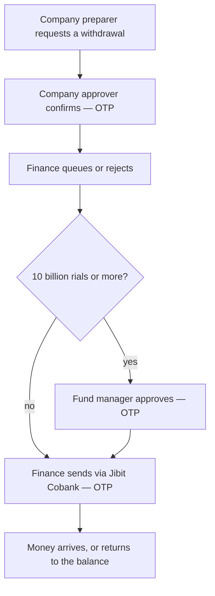

# User stories — what the platform supports today

_Version 3 · 2026-11-27 · Based on the code on `main` (master plan v0.27). Stories marked **(API only)** work in the
backend but have no screen yet. Update this document together with the code (01 §7)._

Three groups use the platform: **companies that invest**, **companies that want financing (applicants)**, and **fund
staff**. Every company starts with the same onboarding, then follows the path it chose at registration (invest,
financing or both). The steps after the limit check (due diligence, committee, contracts, series, subscriptions,
payouts) are not built yet (D-C22).

## 1. Every company

**Account and login**
- As a new user, I sign up with my mobile number (or email) and a 6-digit code; no password. This browser is remembered as my device.
- As a user, I verify my national code against my mobile (Shahkar) before I can act for a company.
- As a user who belongs to several companies, I switch between them from the header.
- As a user, I see and revoke my logged-in devices. **(API only)**
- Login codes and confirmation codes are throttled separately: confirming an action right after logging in, or two different actions in a row, is never refused.

**Company and team**
- As the first user, I register the company with its 11-digit national ID and become its admin.
- As an admin, I choose what the company does here: invest, get financing, or both. When I choose financing I am told that credit assessment does not mean the fund will grant financing or services.
- As an admin, I invite members (preparer, approver, viewer) by mobile or email with OTP; the code reaches them even if the server crashes right after the invitation. I can revoke an invitation.
- As an admin, I change a member's role or suspend them. **(API only)**
- With two or more members, money actions need two people: one prepares, the other approves with OTP. A one-person company does both.

**Company verification (KYB)**
- As an admin, I fetch the company's official registry record (Jibit), add contact details, upload the articles of association, the latest gazette and, if I am not a listed director, an introduction letter, and submit with OTP.
- As an admin, I see the status and the reason if the fund asks for more information or rejects it, and submit again.
- Before KYB expires I get reminders; when it expires the digital ID is suspended until I renew, and renewing reinstates it.

**Digital ID, bank, everyday**
- As a verified company, I get a digital ID wallet registered on Polygon automatically.
- As an admin, I add the company's IBAN with OTP: verified at once if the bank's owner matches the company, otherwise checked by compliance. Withdrawals to a new account open after 24 hours.
- As a member, I get in-app and SMS notifications, and see tasks the fund assigns to the company.
- As a member, I open a support ticket with the fund. **(API only)**

## 2. Companies that invest

Investing itself (offerings, subscriptions) is not built yet. Today an investor company can:
- See its payment ID and the fund's collection IBAN, and transfer money from one of its verified accounts. A matching deposit is credited; a known payment ID with a mismatch is held for compliance; an unknown one is refunded.
- See available, reserved and in-withdrawal balances and a statement.
- Request a withdrawal (preparer), approve it with OTP (approver), or cancel it before the fund takes it on.

## 3. Companies that want financing (applicants)

**Credit case**
- When I submit KYB with the financing purpose, my credit case opens by itself, pre-filled from KYB; the articles and gazette I uploaded at KYB already count. At the start I am told that credit assessment and the credit limit do not mean the fund will grant financing or services.
- I fill in the 9 form sections and see, while typing, what is missing in each.
- I enter the **current-year trial balance** (to the end of the last completed season, shown; **not in spring**, when only the four years are needed) and **four years** of statements, in million rials, with automatic totals and a balance check. The fund calculates the limit twice: on the four years of statements, and on the trial balance plus the three latest years.
- I upload documents into a checklist with one slot per person, year, location or bank account:
  - **financial statements** and **tax returns** for each of the four years — for a year without a tax return I upload a letter and choose the reason (newly established, inactive, exempt, other);
  - **ID papers**: every page of the birth certificate and both sides of the national card, as several files;
  - **six-column trial balance of the current year up to the end of the last completed season** (the period is shown; not asked for in spring), at the general, subsidiary and detail levels (one file per level);
  - **insurance list** (no payment receipt);
  - **first pages of important contracts or sales invoices**, as many files as needed;
  - **product catalogue** (required);
  - the **Etebarito credit report** for the company and each director, with a step-by-step guide on getting it;
  - the **lease** or title deed of each location (no template; it shows the company has a real location), and the **credit-inquiry permission form** (a template may be offered later);
  - There is no signature-certificate document: the digital signature is taken in the system.
- I write the request letter and sign it with OTP, pay the assessment fee from the balance (unless the fund waives it or exempts the company), accept the commitment and submit with OTP. Until then the case page lists exactly what blocks submission.
- If the fund sends items back, I see its note on each, fix only those and resubmit; extra documents the fund asks for appear in my checklist.
- I reply to the fund's comments on any item. **(API only)**
- I confirm the proposed visit date or ask for another (a ticket). The proposal tells me that two assessors and one specialist from the fund will come and that the CEO, with one technical or financial staff member, must be present.
- Until the fund decides, my case shows "awaiting the fund's decision". Then I see my credit limit (and the collateral it is based on), validity, usage, ceilings with other collateral and the compliance officer's explanation of the numbers — never the scoring coefficients — or a decline with the explanation. If the fund adjusts the limit later, I am notified. With the limit, I can go on to request the fund's services (to be defined).

**Financing applications**

- As a preparer, I describe the project, upload evidence that it has started, set a binding amount within my remaining limit and save a draft (the form still asks for a proposed rate; the fund sets the final rates later).
- As a preparer I send it for approval; as an approver I submit it with OTP.
- If it is returned, I complete the fund's tasks and resubmit; if there is an application fee, I pay it (or the fund waives or exempts it).
- I follow its stage; I can withdraw it with a reason; an inactive application expires after 60 days.

## 4. Fund staff

**Compliance officer** — KYB queue (registry next to the declaration, risk warnings, the introduction letter; approve, reject, ask for information); bank accounts that did not match; held deposits: credit to the right company or refund **(API only)**.

**Analyst** — takes a case; reviews each document in a viewer (every open is logged) and each form section; asks for extra documents; returns the case or declares documents complete; corrects figures with a reason and locks them; records credit-bureau and Sana inquiries **(API only)**; proposes the visit and the visitor; scores with Rc, Ra, Re and reasons while watching both calculations live (A: four years of statements; B: trial balance + three years); if B is higher, checks the trial balance against the tax returns and other documents before B can be used; sends the round with a summary; records guarantees the company already holds **(API only)**; screens applications and runs the limit check; leaves internal notes **(API only)**.

**Credit manager (مدیر اعتبارات)** — everything an analyst does, plus dividing cases between analysts (the queue shows who owns each case, and each analyst has "my cases").

**Compliance officer (credit case)** — receives the analyst's round, sends it to the fund manager with a comment or back to the analyst with the reason (never a round they prepared); after the fund manager's decision, releases it to the company with an explanation of the numbers (this issues the limit, or tells the company it was declined).

**Technical expert** — files the visit report and records originals received.

**Fund manager (the fund's CEO)** — decides on each limit after the compliance officer's referral: confirms the committee meeting was held and enters its date; sees both calculations, each period separately (the trial balance marked as not annualised), and the guarantee and facility ceilings for each collateral; may edit those numbers; accepts or declines with a comment, with OTP (never a round they prepared); **adjusts an issued limit** up or down by changing Rc/Ra/Re or the collateral class, with a live preview, a reason and OTP (the old limit is kept in history; the company is notified); **exempts a company from a fee in advance** (assessment or application fee, OTP; unpaid invoices are waived), or waives single invoices; publishes fee tariff versions (a fee can also be set to zero for everyone); uploads templates for checklist items (currently the credit-inquiry form only); approves large withdrawals (10 billion rials and above); edits the scoring method and rate policy **(API only)**.

**Finance officer** — takes withdrawals into the finance queue or rejects them, sends them through Jibit Cobank with OTP; sees invoices; trial balance **(API only)**.

**Super admin and auditor** — staff roles from the command line, jobs, chain retries **(API only)**; read-only access and the audit-log check **(API only)**.

## 5. What happens automatically

Deposits are checked and credited or held; bank transfers are confirmed or reversed; digital-ID changes go to the chain
with retries; SMS and invitation codes are delivered; KYB reminders and expiry; inactive applications expire; credit
limits expire after 12 months; inactive cases close; unanswered tickets escalate to the fund manager after a business
day; visit reminders.
